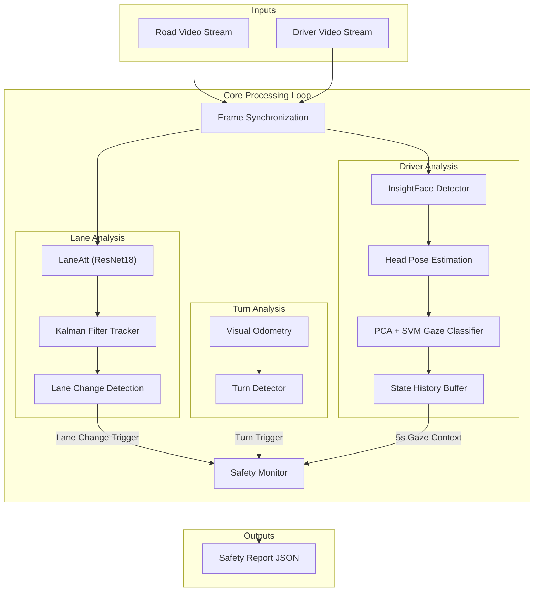

# SafeDrive - Driver Mistake Identification System

A multi-modal computer vision system that detects unsafe driving behaviours by correlating vehicle manoeuvres - lane changes and turns - with driver mirror-checking behaviour. It processes dual video streams (forward-facing dashcam + interior-facing camera) frame-by-frame, using deep learning for lane detection, visual odometry for turn detection, and head pose estimation for gaze classification. A rule-based safety monitor checks whether the driver looked at the appropriate mirror before each manoeuvre, flagging unsafe events (e.g., merging without checking mirrors).

Developed as a CS310 final-year project at the University of Warwick.

**Live deployment:** https://safedrive.dcs.warwick.ac.uk/

## Repository Structure

```
driver_mistake_identification/
  combined_analysis/   Core analysis pipeline (lane + face + safety logic)
  web_application/     Full-stack web app (React frontend, FastAPI backend)
  visual_odometry/     Monocular visual odometry from dashcam video
  lane_detection/      Lane detection model (wraps the lanedet library)
  face_analysis/       Head pose data collection and analysis notebooks
  start_server.bash    Production deployment script for the DCS cluster
```

## Prerequisites

- Python 3.10+
- CUDA-capable NVIDIA GPU (recommended for real-time inference)
- Node.js 18+ and npm (for the web frontend)
- FFmpeg (for video transcoding in the web app)

## Environment Setup

### Option A: pip

```bash
# Install PyTorch with CUDA support (adjust cuda version as needed)
pip install torch torchvision --index-url https://download.pytorch.org/whl/cu121

# Install core analysis dependencies
pip install opencv-python insightface scikit-learn numpy scipy tqdm matplotlib onnxruntime-gpu

# Install web application backend dependencies
pip install -r web_application/backend/requirements.txt

# Install lane detection library
cd lane_detection/lanedet
pip install -r requirements.txt
pip install -e .
cd ../..

# Install frontend dependencies
cd web_application/frontend
npm install
cd ../..
```

### Option B: conda

```bash
# Create environment with Python and CUDA-enabled PyTorch
conda create -n safedrive python=3.10
conda activate safedrive
conda install pytorch torchvision pytorch-cuda=12.1 -c pytorch -c nvidia

# Install remaining Python dependencies
pip install opencv-python insightface scikit-learn numpy scipy tqdm matplotlib onnxruntime-gpu
pip install -r web_application/backend/requirements.txt

# Install lane detection library
cd lane_detection/lanedet
pip install -r requirements.txt
pip install -e .
cd ../..

# Install frontend dependencies
cd web_application/frontend
npm install
cd ../..
```

## Architecture Overview



## Quick Start

### Combined Analysis (CLI)

Interactive mode with live visualisation:

```bash
python3 combined_analysis/main.py \
    lane_detection/lanedet/configs/laneatt/resnet18_culane.py \
    --video_base /path/to/recording \
    --load_from lane_detection/lanedet/weights/laneatt_r18_culane.pth \
    --savedir ./output \
    --show
```

The `--video_base` path is appended with `_F.mp4` (face) and `_I.mp4` (road) automatically.

Headless mode (used by the web app):

```bash
python3 combined_analysis/run_headless.py \
    --road /path/to/road.mp4 \
    --face /path/to/face.mp4 \
    --output /path/to/results.json
```

See [`combined_analysis/README.md`](combined_analysis/README.md) for full argument reference.

### Web Application

**Backend** (port 8000):

```bash
cd web_application/backend
pip install -r requirements.txt
python -m uvicorn app.main:app --reload --host 0.0.0.0 --port 8000
```

**Frontend** (port 5173):

```bash
cd web_application/frontend
npm install
npm run dev
```

**Production** (DCS cluster, ports 7727/7728 with SSL):

```bash
./start_server.bash
```

See [`web_application/README.md`](web_application/README.md) for full setup details.

### Other Modules

| Module | Command | README |
|--------|---------|--------|
| Visual Odometry | `python3 visual_odometry/vo_main.py <video> --show` | [`README`](visual_odometry/README.md) |
| Lane Detection | `python3 lane_detection/lanedet/main.py <config> --gpus 0` | [`README`](lane_detection/README.md) |
| Face Analysis | Jupyter notebooks and CSV datasets | [`README`](face_analysis/README.md) |

## Model Weights

Lane detection weights must be downloaded separately:

1. Download from https://github.com/Turoad/lanedet/releases/tag/1.0
2. Place in `lane_detection/lanedet/weights/`

The primary model used is `laneatt_r18_culane.pth` (LaneAtt with ResNet-18 backbone, trained on CULane).

InsightFace models are downloaded automatically on first run.

## Acknowledgements

- [lanedet](https://github.com/Turoad/lanedet) - Lane detection framework (Tu Zheng et al.)
- [InsightFace](https://github.com/deepinsight/insightface) - Face analysis library
- [MediaPipe](https://developers.google.com/mediapipe) - Face landmark detection (used during research)
- University of Warwick, Department of Computer Science
