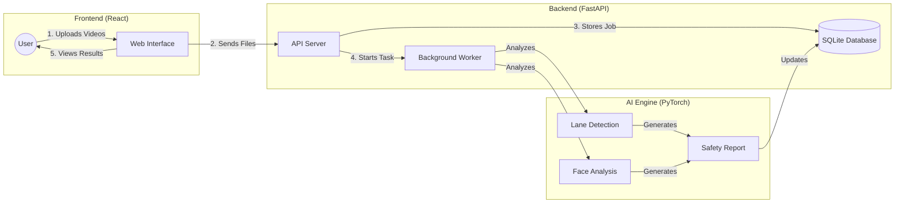
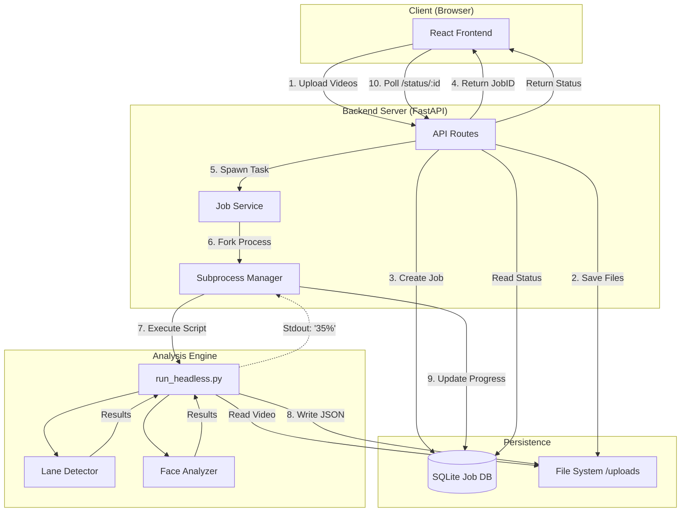

# Driver Mistake Identification - Web Application

This directory contains the full-stack web application for the **Driver Mistake Identification** system. It transforms the core computer vision analysis pipeline into a user-friendly, interactive product. The application is designed as a modular **Client-Server-Worker** system to handle heavy video processing tasks while maintaining a responsive user interface.

---

## High-Level Workflow & Technology

This diagram illustrates the user journey from upload to results, highlighting the specific technologies that power each step of the process.



---

## System Architecture

The application is architected to decouple the heavy computational load of machine learning inference from the user interface. It employs an asynchronous worker pattern where the API server delegates analysis tasks to background processes.



### Key Architectural Decisions

1.  **Asynchronous Worker Pattern**:
    *   **Why?** Video analysis takes significantly longer (minutes) than standard HTTP timeout limits (seconds). Blocking a request for the duration of the analysis would cause the browser to timeout and the UI to freeze.
    *   **How?** The backend accepts the files, returns a `job_id` immediately, and spawns a detached subprocess (`run_analysis_process`) to run the heavy lifting.

2.  **Short Polling for State Management**:
    *   **Why?** We chose simple short polling (every 2s) over WebSockets. Since the analysis is a long-running batch process rather than a real-time chat stream, the overhead of establishing and maintaining WebSocket connections was unnecessary complexity. Polling is stateless, robust, and trivial to debug.

3.  **Subprocess Integration**:
    *   **Why?** Python's Global Interpreter Lock (GIL) can bottleneck CPU-bound tasks like video processing if run within the same thread/process as the AsyncIO API server.
    *   **How?** The `analysis_service.py` spawns a completely separate OS process for `combined_analysis/run_headless.py`. This ensures the API remains responsive even while the CPU is pegged at 100% by the neural networks.

---

## Tech Stack

### Frontend (Client)

*   **React 19**
    *   **Why**: The latest standard for building interactive User Interfaces, offering improved concurrent rendering and state management features.
    *   **How**: Serves as the foundation for the Single Page Application (SPA), managing the DOM updates, component lifecycle, and application state.
*   **Vite**
    *   **Why**: Provides significantly faster development startup times and optimized production builds compared to legacy tools like Webpack.
    *   **How**: Handles Hot Module Replacement (HMR) during development and bundles the JavaScript/CSS assets for deployment.
*   **Bootstrap 5**
    *   **Why**: A reliable, grid-based CSS framework that ensures the application is responsive and visually consistent with minimal custom CSS.
    *   **How**: Used for all layout structures (Containers, Rows, Columns) and UI components (Modals, Progress Bars, Buttons).
*   **Axios**
    *   **Why**: Offers a more powerful and configurable API than the native `fetch`, including automatic JSON transformation and better error handling.
    *   **How**: Manages all HTTP communication with the backend, including the multipart/form-data requests for large video uploads.

### Backend (Server)

*   **FastAPI**
    *   **Why**: A high-performance Python web framework that supports asynchronous programming out of the box, which is critical for handling I/O bound operations like file uploads.
    *   **How**: Defines the REST API endpoints, validates request data using Pydantic, and orchestrates the service layer.
*   **SQLModel**
    *   **Why**: Combines the power of SQLAlchemy (ORM) with the simplicity of Pydantic (validation), reducing boilerplate code.
    *   **How**: Defines the database schema (e.g., `Job` table) and handles all database interactions (CRUD operations).
*   **SQLite**
    *   **Why**: A serverless, zero-configuration database engine. It is ideal for this local-first application where setting up a separate Postgres/MySQL server would be overkill.
    *   **How**: Stores persistent data about analysis jobs (IDs, status, timestamps, and paths to result files) in a local `jobs.db` file.
*   **Python Subprocess**
    *   **Why**: Necessary to bypass the Global Interpreter Lock (GIL) and run heavy computation without blocking the web server's event loop.
    *   **How**: Used to fork a new process that executes the `run_headless.py` script, isolating the analysis environment from the API environment.

### Analysis Engine (Worker)

*   **PyTorch**
    *   **Why**: The de facto standard for deep learning research and deployment. It provides the necessary tensor operations and GPU acceleration.
    *   **How**: Loads and executes the LaneAtt (Lane Detection) neural network model.
*   **OpenCV**
    *   **Why**: The industry standard for real-time computer vision. It is highly optimized for C++ under the hood.
    *   **How**: Handles video file reading (decoding frames), image transformations (resizing, normalization), and visualization (drawing lines on frames).
*   **InsightFace**
    *   **Why**: A specialized library that provides state-of-the-art pre-trained models for face analysis.
    *   **How**: Detects faces in the video stream and regresses the 5 facial landmarks used to calculate head pose angles.

---

## Project Structure

The codebase is strictly separated into `backend` and `frontend` directories to mimic a production microservices layout.

```text
web_application/
├── backend/                  # Python API Server
│   ├── app/
│   │   ├── api/              # REST Endpoints (Routes)
│   │   ├── core/             # Global Config & Settings
│   │   ├── db/               # Database Connection
│   │   ├── models/           # SQLModel Schemas (Job, User)
│   │   └── services/         # Business Logic Layer
│   │       ├── analysis_service.py # Spawns the subprocess
│   │       └── file_service.py     # Handles uploads & cleanup
│   ├── start_server.sh       # Convenience launch script
│   └── jobs.db               # SQLite Database (Auto-created)
│
├── frontend/                 # React UI
│   ├── src/
│   │   ├── components/       # Reusable UI Blocks
│   │   ├── hooks/            # Custom Logic (useJob, useVideo)
│   │   ├── pages/            # Main Views (Upload, Dashboard)
│   │   └── services/         # API Wrapper
│   └── package.json          # Dependencies
│
└── uploads/                  # Shared Storage
    └── {job_id}/             # Isolated directory per job
        ├── results.json      # Final analysis report
        ├── road.mp4          # Source video
        └── face.mp4          # Source video
```

---

## Deep Dive: Components

### Backend Services
*   **`analysis_service.py`**: The bridge between the Web and the AI. It constructs the CLI command to run `combined_analysis/run_headless.py`. Crucially, it monitors the `stdout` of that subprocess to catch progress bars (e.g., `35%|`) and updates the database in real-time so the frontend shows a progress bar.
*   **`file_service.py`**: Handles the complexity of file I/O. It ensures unique IDs for every job, creates isolated directories, and manages file cleanup to prevent disk bloat.

### Frontend Hooks
*   **`useJob.js`**: Encapsulates the polling logic. It exposes simple `status`, `progress`, and `result` variables to the view layer, abstracting away the `setInterval` and error handling logic.
*   **`useVideoPlayback.js`**: A complex hook that synchronizes two `<video>` elements (Road and Driver). It handles "Play", "Pause", and "Seek" events to ensure both videos stay perfectly aligned frame-by-frame.

---

## Setup & Installation

### Prerequisites
*   **Node.js** (v16+) and `npm`
*   **Python 3.9+** (Conda environment recommended)
*   **FFmpeg** installed and available in system PATH (for video processing)

### 1. Backend Setup
The backend runs on port `8000`.

```bash
cd backend

# Install dependencies
pip install -r requirements.txt

# Start the server
./start_server.sh
```
*   **Swagger Docs**: Open `http://localhost:8000/docs` to test API endpoints interactively.

### 2. Frontend Setup
The frontend runs on port `5173`.

```bash
cd frontend

# Install dependencies
npm install

# Start development server
npm run dev
```
*   **Application**: Open `http://localhost:5173` to use the app.

---

## API Reference

| Method | Endpoint | Description |
| :--- | :--- | :--- |
| `POST` | `/api/upload` | Uploads Road & Face videos. Returns `job_id`. |
| `GET` | `/api/status/{job_id}` | Returns `{ status: "PROCESSING", progress: 45 }`. |
| `GET` | `/api/result/{job_id}` | Returns the full JSON analysis report. |
| `GET` | `/static/{path}` | Serves video files and assets. |

---

## Common Issues

*   **"Subprocess Failed"**: Check the backend logs. This usually means the `combined_analysis` dependencies (like `dlib` or `insightface`) are missing in the environment running the backend.
*   **"Video Decode Error"**: Ensure the uploaded videos are standard MP4/H.264 files. Some dashcams use proprietary formats that FFmpeg might struggle with without specific flags.