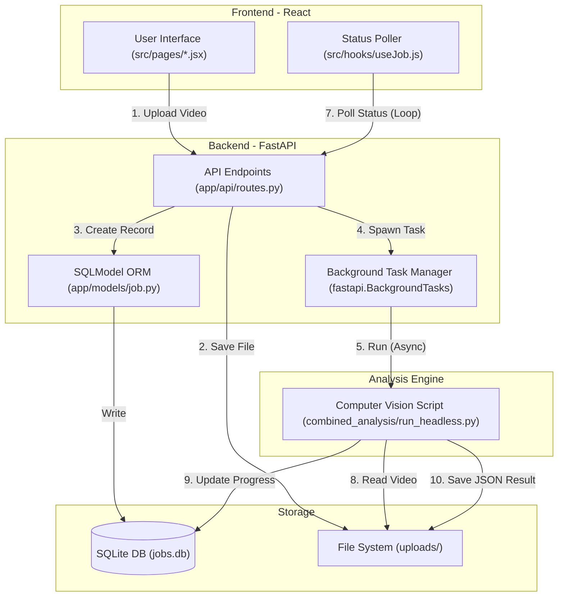
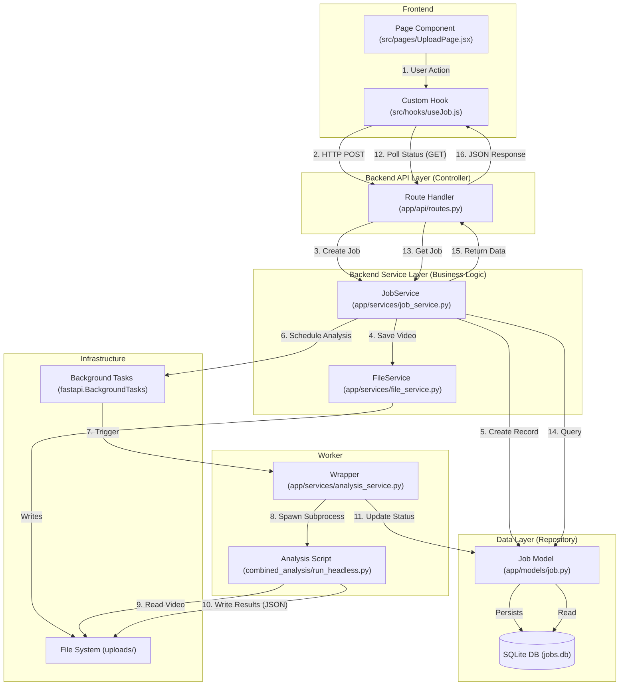

# Web Application Simplification & Architecture Plan

## 1. Executive Summary

This document outlines the plan to refactor the Driver Mistake Identification web application into a clean, modular, and extensible system suitable for a final-year university project.

The goal is not to remove features, but to organize the code into standard **Software Design Patterns**. This demonstrates technical maturity and makes the codebase easier to explain in a report or presentation.

## 2. Architectural Overview

The application adopts a **Client-Server-Worker** architecture, a robust pattern for handling long-running computational tasks (video analysis) without blocking user interaction.

### 2.1. The Components

*   **Client (Frontend):** A Single Page Application (SPA) built with **React**.
    *   *Role:* Handles user interaction, file selection, and importantly, the *visualization* of complex data (video synchronization, canvas overlays).
    *   *Why React?* Unlike server-side rendered templates (e.g., Jinja2), React allows us to build a rich, interactive "Dashboard" state that persists while data is loading. It enables smooth, flicker-free video playback and real-time canvas drawing which is critical for this specific use case.

*   **Server (Backend):** A REST API built with **FastAPI**.
    *   *Role:* Acts as the entry point for data, validates requests, manages the database, and serves static files (videos/results).
    *   *Why FastAPI?* Chosen over Flask or Django for its native support of asynchronous operations (`async/await`). This is crucial because file uploads and IO operations are blocking; FastAPI handles them efficiently. It also provides automatic Swagger documentation and type validation, reducing development error rates.

*   **Worker (Async Task Queue):** Background tasks managed by FastAPI's `BackgroundTasks`.
    *   *Role:* Executes the heavy Computer Vision logic (PyTorch/OpenCV).
    *   *Why this approach?* Video analysis is CPU/GPU intensive and takes time (minutes). If we ran this inside the HTTP request loop, the user's browser would timeout waiting for a response. By offloading it to a background thread/process, the API returns "Job Accepted" immediately, keeping the UI responsive.

*   **Data Persistence:** **SQLite** managed via **SQLModel**.
    *   *Role:* Stores metadata (job status, file paths, analysis results).
    *   *Why SQLite?* It is serverless and creates a single file (`jobs.db`). For a university submission, this is superior to PostgreSQL/MySQL because the marker does not need to install or configure a database server; they simply run the code.

### 2.2. Design Choices & Alternatives Analysis

In designing this system, several alternatives were considered and rejected based on the constraints of a university project (Simplicity, Portability, Clarity).

#### A. Communication: Polling vs. WebSockets
*   **Current Choice:** **Short-Polling**. The Frontend asks "Is job X done?" every 2 seconds.
*   **Alternative:** **WebSockets**. The Server pushes "Job X done" to the client.
*   **Decision:** We chose **Polling**. While WebSockets are more "real-time", they introduce significant state management complexity (handling disconnections, reconnection logic, server memory for open connections). Polling is stateless, robust, easier to debug, and sufficient for tasks taking >10 seconds.

#### B. Storage: Local Filesystem vs. Cloud (S3)
*   **Current Choice:** **Local Filesystem**. Videos are saved to an `uploads/` folder.
*   **Alternative:** **AWS S3 / Google Cloud Storage**.
*   **Decision:** We chose **Local Filesystem**. It ensures the project runs offline and requires no API keys or credit card details, making it safe for submission and archival.

#### C. Backend Framework: FastAPI vs. Flask
*   **Current Choice:** **FastAPI**.
*   **Alternative:** **Flask**.
*   **Decision:** **FastAPI**. Flask is simpler but lacks built-in type safety and async support. FastAPI's Pydantic integration ensures that data moving between Frontend and Backend is strictly validated (e.g., ensuring a job ID is a valid UUID), which catches bugs early in the dev cycle.

### High-Level Diagram



### 2.3. Detailed Backend Structure (Proposed)

This diagram highlights the **Service-Repository Pattern** introduced in the refactoring. It shows how the "Fat Controller" (Routes) is broken down into distinct layers.



## 3. Backend Refactoring Plan

**Goal:** Implement the **Service-Repository Pattern** to decouple business logic from API routes and database access.

### 3.1. Database Layer (The Repository)

**Current State:** 
The application currently uses `sqlite3` directly in `database.py`. It writes raw SQL queries (e.g., `INSERT INTO jobs...`) and manually handles database cursors.
*   **Critique:** This is error-prone. A typo in a column name string is only caught at runtime. Adding a new field requires manually updating the CREATE TABLE string and every INSERT/SELECT query. It couples the code tightly to SQLite syntax.

**Proposed Change:** Use **SQLModel** (Pydantic + SQLAlchemy).
*   **Implementation:** Define a `Job` class that inherits from `SQLModel`.
*   **Why this is better:**
    1.  **Type Safety:** Python knows that `job.status` is a string. Your IDE provides autocompletion.
    2.  **Abstraction:** You don't write SQL. You write `session.add(job)`. If you switch to PostgreSQL later, you just change one connection string, not 50 queries.
    3.  **Validation:** It automatically ensures data fits the schema before trying to save it.

**Example `models.py`:**
```python
from sqlmodel import SQLModel, Field
from typing import Optional, Dict

class Job(SQLModel, table=True):
    id: str = Field(primary_key=True)
    status: str
    road_path: str
    face_path: str
    progress: int = 0
    # ... other fields
```

### 3.2. Business Logic Layer (The Service)

**Current State:** 
The `routes.py` file is a "Fat Controller". It handles HTTP requests *and* business logic.
*   **Critique:** The `/upload` endpoint currently: checks for files, creates directories, calls `shutil` to move files, calls `ffmpeg` to splice them, formats the DB entry, and triggers the background task. This makes the route function huge and hard to read. It's impossible to test the file splicing logic without sending a fake HTTP request.

**Proposed Change:** Extract logic into `JobService`.
*   **Implementation:** Create `services/job_service.py`.
*   **Responsibilities:**
    *   `create_job(files)`: Pure python function. Input: file objects. Output: Job object. It handles the saving, splicing, and DB creation.
    *   `get_job_status(id)`: Wraps DB access and formats the response.
*   **Why this is better:**
    1.  **Single Responsibility Principle:** Routes handle *Routing* (HTTP codes, JSON parsing). Services handle *Business* (What happens when a file is uploaded).
    2.  **Reusability:** If you wanted to build a CLI tool later that uploads files, you could import `JobService` and use it directly without a web server.

### 3.3. API Layer (The Controller)

**Current State:** Mixed logic (as described above).
**Proposed Change:** Routes simply call the Service layer.

**Example `routes.py`:**
```python
@router.post("/upload")
def upload(files: List[UploadFile], service: JobService = Depends()):
    # The route is now only 2 lines long!
    return service.create_job(files)
```

## 4. Frontend Refactoring Plan

**Goal:** Implement **Custom Hooks** to separate API integration from UI rendering.

### 4.1. Custom Hooks

**Current State:** 
API calls (axios) likely reside inside `useEffect` or button click handlers within the Page components (`UploadPage.jsx`).
*   **Critique:** The UI component is "smart". It knows about URLs, HTTP headers, and error codes. This makes the code messy: you have HTML mixed with `try/catch` blocks. If you change the API URL, you have to hunt through UI components to find it.

**Proposed Change:** Create `hooks/useJob.js`.
*   **Implementation:**
    *   `useJobUpload()`: Returns `{ upload, progress, isUploading, error }`.
    *   `useJobStatus(jobId)`: Returns `{ status, result }`. It encapsulates the polling logic (`setInterval`) internally.
*   **Why this is better:**
    1.  **Separation of Concerns:** The View (Component) only asks "Is it uploading?". It doesn't care *how*.
    2.  **Readability:** The component code becomes declarative: `if (isUploading) return <ProgressBar />`.
    3.  **Testability:** You can test the logic of the hook separately from the rendering of the page.

### 4.2. Component Organization

**Current State:** Components are likely grouped loosely.
**Proposed Change:** Strict separation by domain.
*   `components/common/`: Generic UI elements (Buttons, Loading Spinners, Alert Boxes) that could be used in *any* project.
*   `components/features/`: Domain-specific elements (`VideoPlayer`, `Timeline`, `EventList`) that only make sense for *this* project.

## 5. Implementation Steps

1.  **Backend Data Model:** Replace `database.py` with `models/job.py` using SQLModel.
2.  **Backend Services:** Create `services/file_service.py` (for video ops) and `services/job_service.py` (for orchestration).
3.  **Refactor Routes:** Update `routes.py` to use the new services.
4.  **Frontend Hooks:** Extract API logic from `UploadPage` and `StatusPage` into `useJobUpload` and `useJobStatus`.
5.  **Documentation:** Update `README.md` to explain this architecture (Critical for Uni projects).

## 6. Future Expansion (For the Report)

This architecture allows for easy expansion, which is a key point to mention in your project report:
*   **Switch Database:** Because we used SQLModel (ORM), changing to PostgreSQL for production is a configuration change, not a code rewrite.
*   **Scale Workers:** Because we separated the Service logic, we could move `run_analysis_process` to a separate server (using Celery/RabbitMQ) without breaking the API.
*   **Cloud Storage:** We can create a new `S3FileService` that looks just like `FileService` but uploads to AWS. The API routes wouldn't know the difference.

## 7. Source Control Hygiene

A critical part of a "clean" project is ensuring only source code is committed.

*   **Problem:** Currently, the root `.gitignore` is too sparse. `jobs.db`, `__pycache__`, and potentially `.env` files might be tracked.
*   **Action:** Add a comprehensive `.gitignore` to `web_application/backend/` and the project root.
*   **Content:**
    ```gitignore
    # Python
    __pycache__/
    *.py[cod]
    *$py.class
    *.so
    
    # Database
    *.db
    *.sqlite3
    
    # Environment
    .env
    venv/
    env/
    
    # IDEs
    .vscode/
    .idea/
    ```
